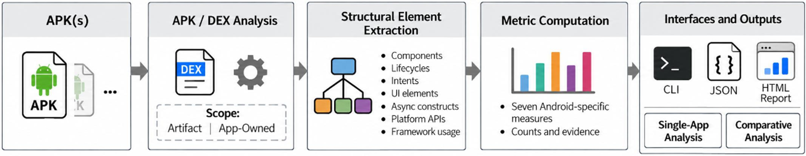
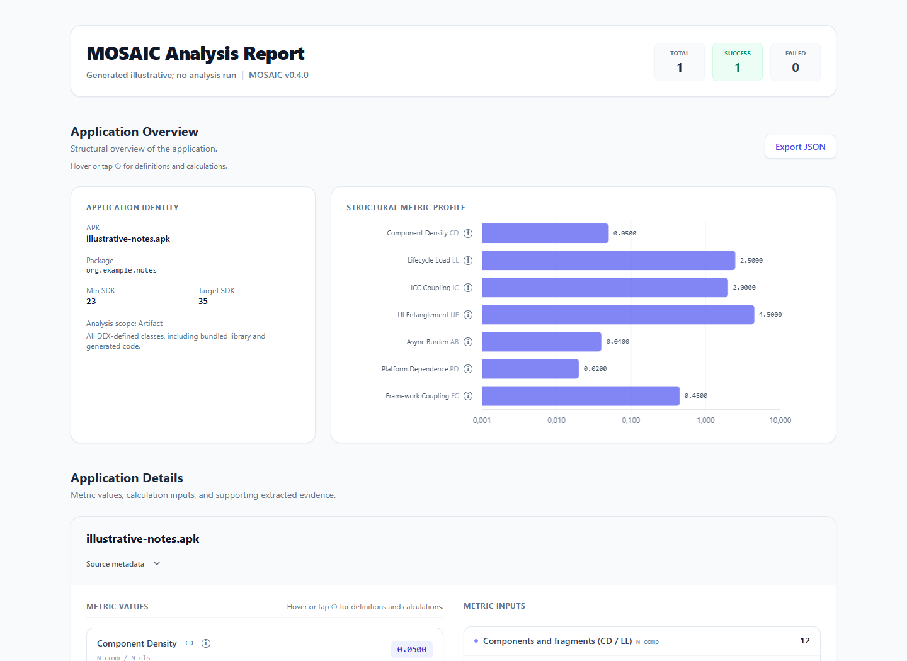
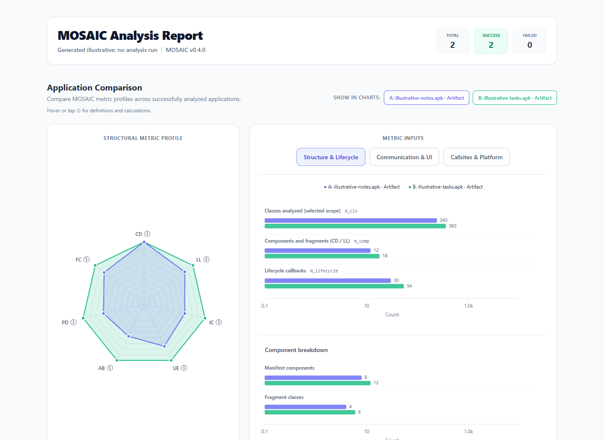

# MOSAIC

**Android structural quality metrics from APKs.**

[](https://nexus-software-lab.github.io/)
[](https://github.com/NEXUS-Software-Lab)
[](https://github.com/orgs/NEXUS-Software-Lab/packages/container/package/mosaic)
[](https://github.com/NEXUS-Software-Lab/MOSAIC/releases/latest)
[](pyproject.toml)
[](LICENSE)

MOSAIC analyzes Android application packages to characterize their structure, lifecycle responsibilities, inter-component communication, UI entanglement, and dependence on asynchronous constructs and platform APIs. It computes **seven Android-specific measures** and exports their values together with underlying counts, structural evidence, and analysis provenance.

Use MOSAIC to inspect a single application or compare several APKs through an interactive HTML report. JSON exports support further analysis and reproducible research workflows. Analysis is static: application source code, an emulator, and a running Android device are not required.

[Quickstart](#quickstart) · [Overview](#overview) · [Usage](#usage) · [Example-exports](#example-exports)

## Quickstart

### Docker

Install Docker with Linux container support. Put an APK named `app.apk` in your current directory, then run:

```sh
docker pull ghcr.io/nexus-software-lab/mosaic:latest
docker run --rm -v "${PWD}:/data" ghcr.io/nexus-software-lab/mosaic:latest analyze /data/app.apk --format json,html --output /data/results
```

These commands work in Bash and PowerShell. The mounted directory receives `results.json` and `results.html`. Open the HTML file in a browser. The container runs as a non-root user (UID 10001), so the mounted output directory must be writable by that user on Linux.

Images are published for `linux/amd64` and `linux/arm64` with both a **versioned tag** and **`latest`**. Each successful release build overwrites `latest`; run `docker pull` again to refresh your local copy. For reproducible runs, choose a version from the [releases](https://github.com/NEXUS-Software-Lab/MOSAIC/releases) or use the immutable image digest in the release notes.

<details>
<summary>Build the container locally</summary>

From a checkout of this repository:

```sh
docker build -t mosaic:local .
docker run --rm -v "${PWD}:/data" mosaic:local analyze /data/app.apk --format json,html --output /data/results
```

</details>

### Local Python

Requires **Python 3.10 or newer**. Clone the repository and install MOSAIC in a virtual environment:

```sh
git clone https://github.com/NEXUS-Software-Lab/MOSAIC.git
cd MOSAIC
python -m venv .venv
```

Activate the environment on Linux/macOS:

```sh
source .venv/bin/activate
```

Or in Windows PowerShell:

```powershell
.\.venv\Scripts\Activate.ps1
```

Install and analyze an APK:

```sh
python -m pip install .
mosaic analyze path/to/app.apk --format json,html --output results
```

This produces `results.json` and `results.html`. Python dependencies, including Androguard, are installed automatically.

## Overview



MOSAIC uses Androguard to inspect the manifest and DEX bytecode, extracts Android-specific structural elements and callsites, and computes the following measures for the selected analysis scope.

| Measure | What it captures | Calculation |
| --- | --- | --- |
| **CD** · Component Density | Organization into Android components and fragments | Components and fragments / analyzed classes |
| **LL** · Lifecycle Load | Lifecycle responsibilities per component | Lifecycle callbacks / components and fragments |
| **IC** · ICC Coupling | Inter-component communication intensity | ICC callsites / manifest endpoints, including activity aliases |
| **UE** · UI Entanglement | Non-UI work within UI classes | Non-UI callsites in UI classes / UI classes |
| **AB** · Async Burden | Use of asynchronous and concurrent constructs | Async callsites / all callsites |
| **PD** · Platform Dependence | Use of resource-sensitive platform APIs | Resource-sensitive callsites / all callsites |
| **FC** · Framework Coupling | Calls to Android and AndroidX APIs | Framework callsites / all callsites |

Callsites are Dalvik `invoke` instructions in analyzed methods. Metrics are rounded to four decimal places; a zero denominator produces `0.0`. These measures describe structural characteristics and should be interpreted in context, rather than as a single quality score.

## Usage

```sh
# Analyze one APK; JSON is printed to standard output by default.
mosaic analyze app.apk

# Compare two APKs in an HTML report.
mosaic analyze app-v1.apk app-v2.apk --format html --output comparison.html

# Recursively analyze all *.apk files in a directory and export both formats.
mosaic analyze path/to/apks/ --format json,html --output results

# Restrict analysis to the application's package namespace.
mosaic analyze app.apk --scope app-owned --format json,html --output app-owned

# Show all options.
mosaic analyze --help
```

The same arguments work with Docker: replace `mosaic` with `docker run --rm -v "${PWD}:/data" ghcr.io/nexus-software-lab/mosaic:latest` and use paths inside `/data`.

| Option | Purpose | Default |
| --- | --- | --- |
| `--scope artifact\|app-owned` | Select the code included in analysis | `artifact` |
| `--format`, `-f` | Export `json`, `html`, or `json,html` | `json` |
| `--output`, `-o` | Write to a file; both formats use the supplied name with `.json` and `.html` suffixes | Standard output |
| `--verbose`, `-v` | Show Androguard debug output | Off |

When exporting both formats, `--output` is required. Create the destination directory before running the command.

### Analysis scope

- **`artifact`** includes all DEX-defined classes, including bundled libraries and generated code.
- **`app-owned`** includes classes under the APK package namespace and excludes `R`, `R$*`, and `BuildConfig`. This is a package-prefix heuristic: application code outside that namespace is excluded, and matching library code may remain.

Use the same scope when comparing APKs. The exports record the scope and its definition alongside the tool versions and APK hash.

## Example exports

The examples below use **synthetic data for illustration**, not measurements from real applications or experimental results. Hashes and provenance are placeholders, and evidence lists are abbreviated. The HTML files are generated using MOSAIC's report renderer.

### HTML report

A single-app report presents application identity, the metric profile, and expandable details for metrics, counts, evidence, and provenance.



A multi-app report adds comparison charts and a metric summary; reports with exactly two successful analyses also show absolute and relative differences.



The report loads Tailwind CSS, Chart.js, and its data-label plugin from CDNs, so internet access is needed for styling and interactive charts.

### JSON export

One APK produces a JSON object; multiple APKs produce an array of objects. Each successful record contains application metadata, seven metric values, raw counts, structural evidence, and provenance.

```json
{
  "apk_path": "illustrative-notes.apk",
  "apk_sha256": "0000000000000000000000000000000000000000000000000000000000000000",
  "package": "org.example.notes",
  "version_code": "1",
  "analysis_scope": "artifact",
  "sdk": {
    "min": "23",
    "target": "35"
  },
  "metrics": {
    "CD": 0.05,
    "LL": 2.5,
    "IC": 2.0,
    "UE": 4.5,
    "AB": 0.04,
    "PD": 0.02,
    "FC": 0.45
  },
  "counts": {
    "classes_analyzed_total": 240,
    "components_total_for_cd_ll": 12,
    "manifest_components": 8,
    "activity_aliases": 0,
    "fragment_classes": 4,
    "icc_components_for_ic": 8,
    "lifecycle_callbacks": 30,
    "icc_callsites": 16,
    "ui_classes": 10,
    "ui_nonui_callsites": 45,
    "async_callsites": 160,
    "resource_callsites": 80,
    "callsites_total": 4000,
    "callsites_framework_android_androidx": 1800
  },
  "provenance": {
    "mosaic_version": "0.4.0",
    "androguard_version": "illustrative; no APK analyzed",
    "taxonomy_version": "illustrative",
    "run_timestamp": "illustrative; no analysis run",
    "analysis_scope": "artifact",
    "scope_definition": "all DEX-defined classes",
    "callsite_definition": "Dalvik invoke instructions in analyzed methods",
    "framework_definition": "target class starts with Landroid/ or Landroidx/"
  },
  "evidence": {
    "manifest_components": [
      {
        "name": "org.example.notes.MainActivity",
        "dalvik_name": "Lorg/example/notes/MainActivity;",
        "type": "activity"
      }
    ],
    "activity_aliases": [],
    "fragment_classes": [],
    "ui_classes": [
      "Lorg/example/notes/MainActivity;"
    ]
  }
}
```

Failed analyses contain an `error` field; MOSAIC still exports the collected records and exits with status `1` if any APK fails.

To generate the documentation examples after installing MOSAIC:

```sh
python docs/examples/render_examples.py
```

## License

MOSAIC is released under the [MIT License](LICENSE) by [NEXUS Software Lab](https://nexus-software-lab.github.io/).
